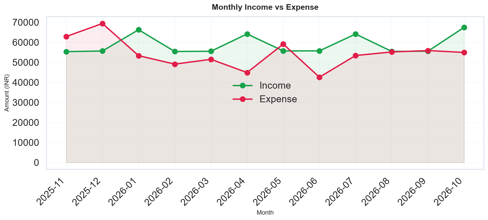
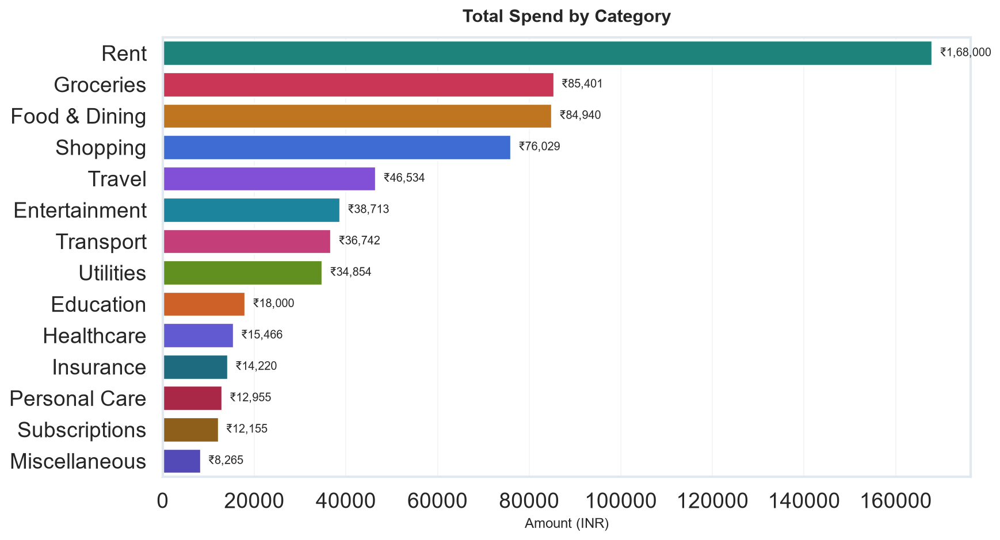
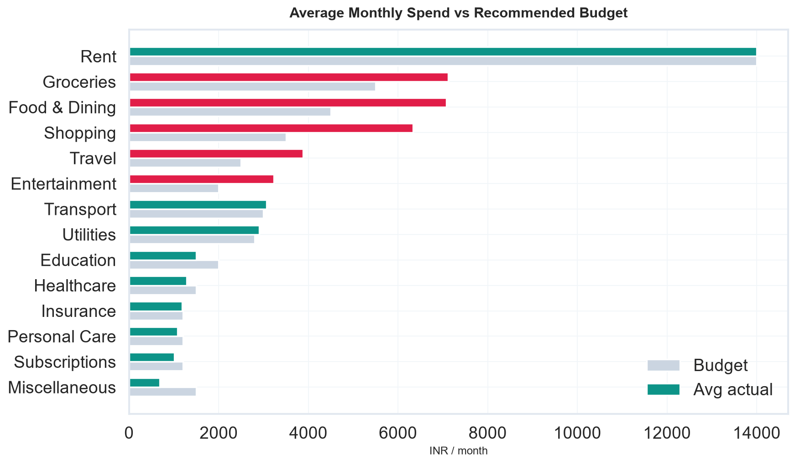

# Expense Tracker App using Data Science

[](https://python.org)
[](https://pandas.pydata.org)
[](https://streamlit.io)
[](LICENSE)

A placement-ready **personal-finance analytics project**. It turns a 12-month synthetic expense ledger (Hyderabad junior analyst persona) into cleaned data, KPIs, category & trend analysis, anomaly detection, a next-month forecast, and an interactive Streamlit dashboard.

> Built for **Data Analyst / Business Analyst / Financial Analyst** internships. No real bank data is used.

---

## Why this project exists

Raw UPI / card / cash logs are noisy. People and finance teams still need answers to:

- Where did the money actually go?
- Which categories are over budget?
- Is weekend spending a leak?
- What will next month roughly cost?
- Are there unusual transactions worth a second look?

This repo is a miniature version of the spend-intelligence layer inside products like **Google Pay, PhonePe, CRED, Mint, Splitwise, RazorpayX**.

**Workflow**

```
data input → storage → cleaning → feature engineering
        → analysis → visualization → insights → decision-making
```

---

## Features

- Synthetic but realistic **INR ledger** (Nov 2025 – Oct 2026) with Hyderabad merchants
- Intentionally **dirty raw CSV** (mixed dates, missing values, duplicates) + a proper cleaning pipeline
- Feature engineering: month, weekday, weekend flag, festival month, amount band, signed cash-flow
- Category, monthly, weekday, payment-method, merchant and **Pareto (80/20)** analysis
- **Budget vs actual** against recommended monthly envelopes
- **Anomaly detection** (modified z-score within category)
- **Next-month expense forecast** (linear trend blended with 3-month MA)
- **Financial health score** (0–100) from savings rate, budget discipline, spend stability
- 10 static charts + a dark **Streamlit dashboard** with filters and CSV export

---

## Tech stack

| Layer | Tools |
|---|---|
| Language | Python 3.10+ |
| Data | Pandas, NumPy |
| Viz | Matplotlib, Seaborn, Plotly |
| App | Streamlit |
| Excel I/O | openpyxl |

**Student recommendation:** this repo is **Option B (Intermediate)** — Python + EDA + Streamlit. Easy enough to explain in an interview, substantial enough for GitHub.

---

## Architecture

```
                    ┌──────────────────────┐
   persona rules    │  src/data_generator  │
   + seasonal mix   │  → data/raw_*.csv    │
                    └──────────┬───────────┘
                               ▼
                    ┌──────────────────────┐
   missing/dupes/   │  src/preprocessing   │
   mixed types      │  → cleaned_*.csv     │
                    └──────────┬───────────┘
                               ▼
              ┌────────────────┴────────────────┐
              ▼                                 ▼
   src/analysis.py + insights.py        src/visualization.py
   KPIs, budget, anomalies, forecast    10 PNG charts
              │                                 │
              └────────────────┬────────────────┘
                               ▼
                     Streamlit  app.py
                     + outputs/reports/
```

**Input fields:** Date, Category, Description, Merchant, Amount, Type (Income/Expense), Payment_Method, City.

---

## Project structure

```
Expense-Tracker-App/
├── app.py                 # Streamlit dashboard
├── main.py                # one-command pipeline
├── requirements.txt
├── README.md
├── data/
│   ├── raw_expenses.csv
│   └── cleaned_expenses.csv
├── src/
│   ├── config.py
│   ├── data_generator.py
│   ├── preprocessing.py
│   ├── analysis.py
│   ├── insights.py
│   └── visualization.py
├── notebooks/
│   └── 01_expense_eda.ipynb
├── outputs/
│   ├── charts/            # 10 analysis PNGs
│   └── reports/           # CSVs + insights.txt
├── docs/
│   ├── PROJECT_GUIDE.md   # full 16-section write-up
│   ├── INTERVIEW_PREP.md
│   └── GITHUB_GUIDE.md
└── .streamlit/config.toml
```

---

## Quick start

```bash
git clone https://github.com/<your-username>/Expense-Tracker-App.git
cd Expense-Tracker-App

python -m venv .venv
# Windows: .venv\Scripts\activate
# macOS / Linux:
source .venv/bin/activate

pip install -r requirements.txt
python main.py              # generate + clean + analyse + charts
streamlit run app.py        # interactive dashboard
```

### Expected CLI output

- `data/raw_expenses.csv` — messy ledger
- `data/cleaned_expenses.csv` — analysis-ready
- `outputs/charts/*.png` — 10 figures
- `outputs/reports/insights.txt` — numbered narrative insights
- printed KPIs (income, expense, savings rate, health score, forecast)

---

## Sample insights (seed = 42)

From the committed run (`python main.py`):

- **₹7.06 L income** vs **₹6.51 L expense** over ~11.5 months → **₹54,909 net (7.8% savings rate)** — below the 20% planner rule of thumb
- **Rent ₹1.68 L** is the largest category (25.8%); **Groceries + Food & Dining** are the main *behavioural* lever
- **5 categories over budget** on a monthly-average basis (combined leak ~₹9.6k / month)
- Tightest month: **Dec 2025 (Diwali / year-end), net −₹14,420**; best: **Apr 2026, +₹19,268**
- Financial health score **53/100 (Fair)**; next-month expense forecast **₹53,264**

Full narrative: [`outputs/reports/insights.txt`](outputs/reports/insights.txt).

---

## Charts (generated)

| # | File | What it shows |
|---|---|---|
| 1 | `01_category_bar.png` | Spend by category |
| 2 | `02_category_pie.png` | Share of wallet |
| 3 | `03_monthly_income_expense.png` | Income vs expense trend |
| 4 | `04_monthly_net_savings.png` | Month-wise surplus / deficit |
| 5 | `05_weekday_spend.png` | Weekend vs weekday |
| 6 | `06_payment_method.png` | UPI / card / cash mix |
| 7 | `07_budget_vs_actual.png` | Envelope vs reality |
| 8 | `08_top_merchants.png` | Where rupees actually land |
| 9 | `09_weekday_month_heatmap.png` | Seasonality |
| 10 | `10_pareto.png` | 80/20 of categories |





---

## How to talk about this in interviews

**30-second version**

> I built a spend-analytics system on 12 months of synthetic Indian transaction data. I cleaned a dirty extract, engineered time and behavioural features, analysed category / trend / budget variance, flagged anomalies, forecast next month’s expense, and shipped it as a Streamlit dashboard a finance intern could actually use.

Longer Q&A: [`docs/INTERVIEW_PREP.md`](docs/INTERVIEW_PREP.md).  
End-to-end walkthrough: [`docs/PROJECT_GUIDE.md`](docs/PROJECT_GUIDE.md).

---

## Future improvements

- Bank / UPI CSV upload (real statements)
- Recurring-bill detection and “unused subscription” alerts
- Prophet / ARIMA forecast vs the current linear+MA blend
- Goal tracking (emergency fund, trip, certifications)
- Multi-user / family split (Splitwise-style)
- Mobile wrapper (PWA) and Streamlit Cloud deploy

---

## License

MIT — use this as a portfolio piece, customise the persona, and push it to your own GitHub.
